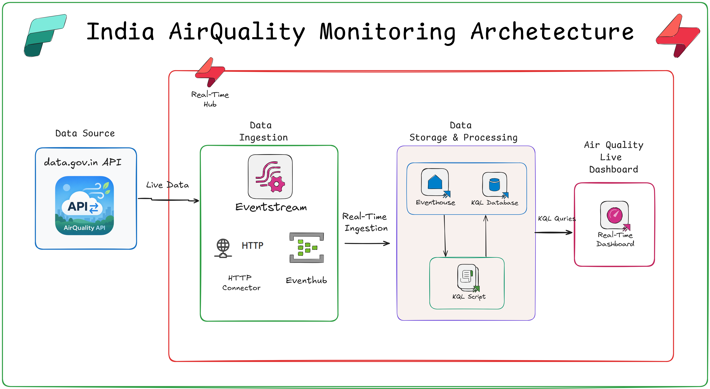

# 🌍 Real-Time Air Quality Monitoring in India with Microsoft Fabric

## 🚀 Overview

Air quality can change significantly across cities and monitoring stations throughout the day. This project demonstrates how **Microsoft Fabric Real-Time Intelligence** can be used to ingest, process, analyze, and visualize air-quality data in near real time.

The solution uses air-quality data from the **data.gov.in API** and builds an end-to-end real-time analytics pipeline using **Fabric Eventstream, Eventhouse, KQL, and Real-Time Dashboard**.

---

## 🏗️ Solution Architecture



### 🔄 End-to-End Data Flow

**data.gov.in API**  
⬇️  
**Microsoft Fabric Eventstream**  
⬇️  
**Data Transformation & JSON Processing**  
⬇️  
**Fabric Eventhouse**  
⬇️  
**KQL Database & Analytics**  
⬇️  
**Real-Time Dashboard**

---

## 🎯 Project Objectives

This project focuses on building a real-time solution to:

- Ingest air-quality data from the **data.gov.in API**
- Process incoming JSON data using **Fabric Eventstream**
- Transform and select the required air-quality fields
- Store incoming records in **Fabric Eventhouse**
- Analyze the data using **Kusto Query Language (KQL)**
- Calculate and analyze PM2.5-based metrics
- Visualize air-quality information through a **Real-Time Dashboard**
- Explore city, station, trend, and geographic-level insights

---

## 🧩 Microsoft Fabric Components Used

| Fabric Component | Purpose |
|---|---|
| **Eventstream** | Ingests and transforms incoming air-quality data |
| **Eventhouse** | Stores real-time air-quality records |
| **KQL Database** | Enables fast querying and analysis |
| **KQL** | Performs data exploration, filtering, and calculations |
| **Real-Time Dashboard** | Visualizes real-time air-quality insights |

---

## 🔌 Data Source

The solution uses the **data.gov.in API** as the source of air-quality information.

The incoming API response contains JSON records that are processed within Fabric Eventstream before being written to Eventhouse.

---

## ⚙️ Data Processing Flow

### 1️⃣ Data Ingestion

The **HTTP connector** in Fabric Eventstream is used to connect to the data.gov.in API and receive air-quality records.

### 2️⃣ Data Transformation

The incoming JSON structure is transformed within Eventstream.

The `records` array is expanded and the required fields are selected for downstream analytics.

Typical fields used include:

- City
- Monitoring Station
- Pollutant
- Timestamp
- Latitude
- Longitude
- PM2.5

### 3️⃣ Data Storage

The transformed data is continuously pushed into an **Eventhouse** table named:

`AirQualityData`

### 4️⃣ Data Analysis

**KQL** is used to query and analyze the incoming air-quality data.

The analysis includes:

- PM2.5 analysis
- Timestamp handling
- Missing/NA value handling
- City-level analysis
- Station-level analysis
- Trend analysis
- Potential hotspot analysis

### 5️⃣ Visualization

The processed data is presented through a **Real-Time Dashboard** containing key metrics, trends, and geographic visualizations.

---

## 📊 Real-Time Dashboard

The dashboard provides a consolidated view of air-quality information and enables users to explore the data across different locations.

Key visualizations include:

- 📌 KPI metrics
- 📈 Air-quality trends
- 🗺️ Geographic map visualization
- 🏙️ City-level analysis
- 📍 Monitoring-station locations
- 🔎 Interactive filtering

---

## ⚠️ Important Note on AQI Interpretation

The project includes **PM2.5-based calculations for analytical purposes**.

A PM2.5 sub-index should **not be interpreted or labelled as the official overall AQI** without applying the appropriate official AQI methodology and required pollutant inputs.

Data quality, missing readings, and delayed readings should also be considered when interpreting real-time environmental data.

---

## 🔄 End-to-End Architecture Summary

```text
                    ┌──────────────────────┐
                    │    data.gov.in API   │
                    └──────────┬───────────┘
                               │
                               ▼
                    ┌──────────────────────┐
                    │  Fabric Eventstream  │
                    │ Ingestion & Transform│
                    └──────────┬───────────┘
                               │
                               ▼
                    ┌──────────────────────┐
                    │   Fabric Eventhouse  │
                    │   AirQualityData     │
                    └──────────┬───────────┘
                               │
                               ▼
                    ┌──────────────────────┐
                    │         KQL          │
                    │ Query & Analytics    │
                    └──────────┬───────────┘
                               │
                               ▼
                    ┌──────────────────────┐
                    │  Real-Time Dashboard │
                    │ Insights & Monitoring│
                    └──────────────────────┘
```

---

## 💡 Key Takeaways

This project demonstrates how **Microsoft Fabric Real-Time Intelligence** can provide an end-to-end platform for real-time data ingestion, transformation, storage, analytics, and visualization.

The overall pipeline is:

> **data.gov.in API → Eventstream → Eventhouse → KQL → Real-Time Dashboard**

This architecture can serve as a foundation for building other real-time monitoring and analytics solutions using Microsoft Fabric.

---

## 📁 Project Structure

```text
AirQualityRTIBlog/
│
├── rtiimage.png
└── README.md
```

---

## 🔗 KQL Queries

The complete KQL code used in this project is available in this GitHub repository.

---

## 🙌 Conclusion

This project showcases how **Microsoft Fabric Real-Time Intelligence** can transform continuously arriving environmental data into actionable, real-time insights.

By combining **Eventstream, Eventhouse, KQL, and Real-Time Dashboard**, we can build a complete real-time analytics solution without requiring a separate notebook-based polling process.

### 🚀 Microsoft Fabric Real-Time Intelligence

**Ingest → Transform → Store → Analyze → Visualize**
