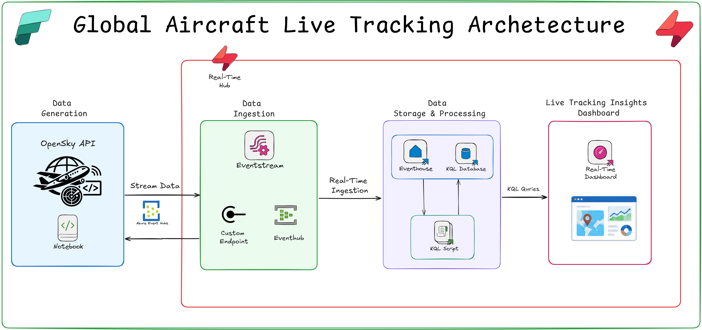

# ✈️ Building a Global Aircraft Live-Tracking System with Microsoft Fabric Real-Time Intelligence

Build a **real-time global aircraft tracking solution** using **Microsoft Fabric Real-Time Intelligence**, **Eventstream**, **Eventhouse**, **KQL**, and **Python**.

This project demonstrates how live flight data from the **OpenSky Network API** can be continuously ingested, streamed, transformed, analyzed, and visualized using Microsoft Fabric.

---

## 🏗️ Architecture



The architecture represents the complete flow from the external OpenSky Network API through Python-based ingestion, Microsoft Fabric Eventstream, Eventhouse/KQL Database, KQL transformations, and finally the Real-Time Dashboard.

---

## 🎯 Project Overview

The goal of this project is to build a **real-time global flight tracking system** capable of continuously processing aircraft telemetry.

The solution uses:

* **OpenSky Network API** – Source of live aircraft data
* **Python** – Polls the API and publishes flight data
* **Microsoft Fabric Eventstream** – Ingests streaming events
* **Eventhouse / KQL Database** – Stores and analyzes real-time data
* **KQL** – Transforms and queries flight telemetry
* **Update Policies** – Automatically transform incoming raw data
* **Real-Time Dashboard** – Provides KPIs, maps, and analytical visualizations

---

## 🔧 Technologies Used

| Technology             | Purpose                                 |
| ---------------------- | --------------------------------------- |
| Microsoft Fabric       | End-to-end analytics platform           |
| Real-Time Intelligence | Real-time data processing and analytics |
| Eventstream            | Streaming data ingestion                |
| Eventhouse             | Real-time data storage and querying     |
| KQL Database           | Real-time analytical layer              |
| KQL                    | Data transformation and analytics       |
| Python                 | API polling and event publishing        |
| OpenSky Network API    | Live aircraft telemetry                 |
| Real-Time Dashboard    | Data visualization and monitoring       |

---

## 📋 Prerequisites

Before implementing this project, you should have:

* Microsoft Fabric capacity or an appropriate Fabric trial
* Basic Python knowledge
* Basic KQL knowledge
* Familiarity with Microsoft Fabric Real-Time Intelligence

---

# 🚀 Implementation

## 1. Create the Fabric Workspace and Eventhouse

Create a dedicated Fabric workspace for the aircraft tracking solution.

Example:

```text
FlightTracking-[WS]
```

Inside the workspace, create an **Eventhouse** / **KQL Database** for storing and querying the incoming flight telemetry.

Example:

```text
FlightTracking-EH
```

A raw ingestion table is used as the landing layer for the incoming streaming data.

```text
RawFlightBatch
```

The raw layer allows the original telemetry to be retained before applying the transformation logic.

---

## 2. Configure Fabric Eventstream

Create an Eventstream to receive the aircraft data.

Example:

```text
GlobalFlightStream
```

The Eventstream is configured with a **custom endpoint**, allowing the Python ingestion process to publish events into the Fabric streaming pipeline.

The Eventstream is subsequently connected to the Eventhouse destination.

This creates the real-time ingestion layer for the solution.

---

## 3. Build the Python Ingestion Process

A Python notebook in Microsoft Fabric is used to retrieve the latest flight information from the OpenSky Network API.

The Python process:

1. Calls the OpenSky Network API
2. Retrieves aircraft state information
3. Processes the response
4. Publishes the data to the Eventstream
5. Continues polling to provide a live stream of aircraft telemetry

The Azure Event Hubs Python package is used to support event publishing.

```text
azure-eventhub
```

The Python notebook therefore acts as the bridge between the external API and Microsoft Fabric's real-time streaming infrastructure.

---

## 4. Ingest Data into Eventhouse

Once the Python process starts publishing events, the Eventstream receives the incoming aircraft telemetry.

The Eventstream then delivers the data into the Eventhouse/KQL Database.

At this stage, the raw aircraft data is available for real-time querying and transformation.

---

# 🔄 5. Transform the Raw Flight Data

The OpenSky Network response contains aircraft state information represented using dense and nested arrays.

To make this data easier to analyze, a cleaned table is created:

```text
FlightStates
```

A KQL parsing function is used to extract the required aircraft attributes from the raw data.

An **update policy** is then configured so that incoming raw records can automatically be transformed into the structured `FlightStates` table.

This creates a simple raw-to-clean transformation pattern:

```text
RawFlightBatch
      ↓
KQL Parsing Function
      ↓
Update Policy
      ↓
FlightStates
```

One of the important KQL techniques demonstrated in this project is `mv-expand`, which can be used to flatten array-based flight-state information.

---

# 📊 6. Build the Real-Time Dashboard

Once the cleaned `FlightStates` table is available, it can be used to create a **Real-Time Dashboard**.

The dashboard provides an operational view of the aircraft data and includes multiple visualization types.

### KPI Cards

Display important operational metrics such as:

* Total aircraft being tracked
* India-origin flights
* Other relevant flight KPIs

### 🌍 Map Visualization

Plot aircraft geographically using their latitude and longitude information.

This provides a real-time view of aircraft locations around the world.

### 📊 Bar Chart

Analyze flight-related categories and distributions using bar charts.

### 🍩 Donut Chart

Provide categorical distribution analysis using a donut visualization.

Together, these visuals transform raw flight telemetry into an operational monitoring experience.

---

# 🌐 Geospatial Analytics

Aircraft telemetry naturally contains geographic information, making this solution suitable for geospatial analysis.

KQL geospatial functions such as:

```kusto
geo_distance_2points()
```

can be used to calculate distances between geographic locations.

This opens the door to scenarios such as:

* Aircraft proximity analysis
* Regional flight monitoring
* Airspace analysis
* Geofencing
* Aircraft density analysis
* Potential congestion detection

---

# 🧠 Key Technical Concepts

This project demonstrates several important Microsoft Fabric Real-Time Intelligence capabilities.

### Real-Time Streaming

Using **Eventstream** to continuously ingest data from an external real-time source.

### Eventhouse

Using **Eventhouse/KQL Database** as the real-time analytical store.

### KQL Data Transformation

Using KQL to transform complex streaming data into a structured analytical format.

### `mv-expand`

Flattening nested arrays and extracting individual aircraft records.

### Update Policies

Automatically applying transformation logic as new streaming data arrives.

### Geospatial Analytics

Using KQL geospatial functions for location-based analysis.

### Real-Time Dashboards

Visualizing continuously changing telemetry through KPIs, maps, and analytical charts.

---

# 🔐 Security Considerations

Never commit sensitive credentials to GitHub.

Avoid publishing:

```text
Connection strings
Access keys
Passwords
API credentials
Secrets
```

Use secure configuration and secret-management mechanisms instead.

For example:

```python
EVENT_HUB_CONNECTION_STRING = "<YOUR_CONNECTION_STRING>"
EVENT_HUB_NAME = "<YOUR_EVENT_HUB_NAME>"
```

---

# 🚀 Possible Extensions

This solution can be extended into more advanced real-time aviation scenarios:

* ✈️ Aircraft proximity detection
* 🌍 Regional flight monitoring
* 🛫 Airport activity monitoring
* 🚨 Geofencing and alerting
* 📍 Aircraft density analysis
* 📈 Real-time flight activity trends
* 🔔 Operational alerts
* 🗺️ Advanced geospatial analytics
* 🤖 Real-time anomaly detection

---

# 📁 Repository Structure

```text
AircraftLiveTrackingRTI/
│
├── README.md
├── AircraftLiveTracking.png
│
├── Notebook/
│   └── AircraftLiveTracking.py
│
├── KQL/
│   ├── FlightStates.kql
│   ├── ParsingFunction.kql
│   └── UpdatePolicy.kql
│
└── Dashboard/
    └── DashboardQueries.kql
```

---

# 🎯 Key Takeaways

* **Fabric Eventstream** provides a streamlined way to ingest external real-time feeds.
* **Eventhouse/KQL Database** provides a real-time analytical environment for flight telemetry.
* **KQL `mv-expand`** simplifies the processing of nested flight-state arrays.
* **Update Policies** automate transformation from raw streaming data into structured analytical data.
* **KQL geospatial functions** enable location-based flight analysis.
* **Real-Time Dashboards** transform streaming telemetry into actionable operational insights.

---

# 💻 Explore the Code

The repository contains the Python ingestion logic and KQL components used to implement the aircraft tracking solution.

The implementation includes:

* Python API polling
* Eventstream ingestion
* Eventhouse configuration
* KQL transformation
* Parsing functions
* Update policies
* Real-Time Dashboard queries

> **Security:** Remove or replace all connection strings, passwords, access keys, and other sensitive configuration before publishing code to GitHub.

---

# 📌 Conclusion

This project demonstrates how **Microsoft Fabric Real-Time Intelligence** can be used to build an end-to-end real-time aircraft tracking solution.

By combining:

**OpenSky Network API + Python + Eventstream + Eventhouse + KQL + Real-Time Dashboard**

we can transform continuously arriving aircraft telemetry into meaningful real-time insights.

The same architectural approach can also be adapted for other real-time use cases such as **IoT telemetry, connected vehicles, logistics, transportation, and geospatial monitoring**.

---

⭐ If you find this project useful, consider starring the repository and sharing it with the Microsoft Fabric community.

